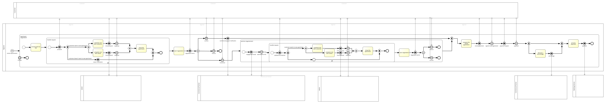
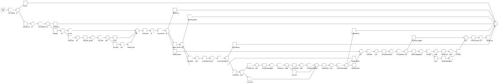
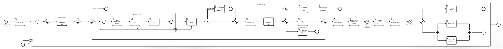
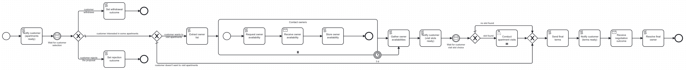

# My Project

## Members of the group:
* member A (Caterina, Gerini, 10810379) 
* member B (Christian, Prendin, 10827556)

## Choreographed process
This is the choreography diagram of our DigiRent apartment rental process. The participants are: Customer, DigiRent, Owner, and Commercial Partner. The process is initiated by the Customer, who submits a rental request to DigiRent. DigiRent first attempts to fulfill the request using its internal apartment database through a propose-and-negotiate phase, which covers apartment shortlisting, optional visit scheduling, and final negotiation. If the internal phase is unsuccessful, DigiRent contacts all available commercial partners in parallel to source additional apartments, iterating through each partner's listings until an agreement is reached or all options are exhausted. The entire process must conclude within 20 days from the initial request; otherwise it is considered terminated. Upon a successful outcome, the customer signs the rental agreement and proceeds with payment. If a commercial partner was involved, DigiRent allocates a percentage of the agency fee to that partner.

  

### Propose and Negotiate — sub-choreography detail

  

## Collaboration Diagram
The collaboration diagram models DigiRent as a white-box pool, showing its full internal orchestration. Customer, Owner, and Commercial Partner are modeled as black-box pools. All interactions between DigiRent and the other participants are made explicit through named message flows.

  

## Petri Net

The Petri Net below corresponds to the orchestrated DigiRent process, derived from the collaboration diagram via standard BPMN-to-Petri-Net mapping. The net (36 places, 47 transitions, 96 arcs) has been verified in WoPeD and satisfies both the Workflow net property and the Soundness property: every reachable state can reach the final marking o, there are no dead transitions, and the process terminates cleanly. 

  

The PNML source file is available at `processes/PetriNet_DigiRent.pnml`

## Third party services

The following participants are modelled as black-box pools in the collaboration diagram. Their REST interfaces are specified in `services/api/Customer_OpenAPI.yaml`, `services/api/Owner_OpenAPI.yaml`, and `services/api/CommercialPartner_OpenAPI.yaml` (one file per participant).
 
**Customer:** initiates the rental process by submitting a request to DigiRent. Throughout the process the Customer retrieves apartment proposals, confirms or declines visit schedules, negotiates final terms, signs the rental agreement and submits payment.
 
**Owner:** owns one or more apartments managed by DigiRent. When visit scheduling is required, DigiRent contacts the relevant Owner(s) to request available time slots. The Owner responds with their availability and receives the rent payment at the end of a successful process.
 
**Commercial Partner:**  an external real-estate agency contacted by DigiRent when the internal apartment search is unsuccessful. The Partner provides a list of available apartments matching the customer's requirements. If the rental is concluded through a partner, DigiRent allocates an agreed percentage of the agency fee to that partner.

## Executable process

The executable model implements the same orchestration described above, deployed
on Camunda 7.24. It is split across two files: `DigiRent.bpmn` (top-level process,
handling the internal/partner phases, the payment closing chain, and the 20-day
boundary timer) and `ProposeAndNegotiate.bpmn` (the reusable "propose and
negotiate" sub-process, invoked via Call Activity once for the internal phase and
once per partner). Compared to the M1 collaboration diagram, the executable model
adds one refinement: if the internal database returns zero matching apartments,
the internal negotiation phase is skipped entirely and the process proceeds
directly to the partner phase, avoiding an unnecessary round-trip with the
customer over an empty list.

Black-box participants (Customer, Owner, Commercial Partner) are simulated by
Node.js/Express mocks — see `services/README.md` for how to run them, and
`services/postman/DigiRent_Postman_Scenari.json` for the full test suite covering
all demo scenarios.

  

  

