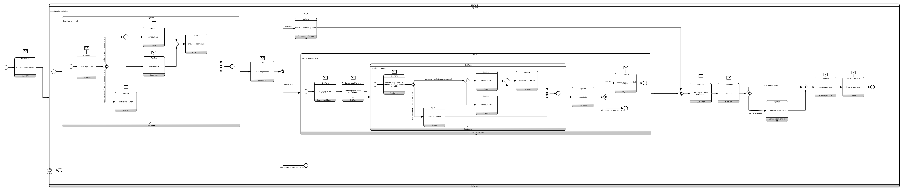

# My Project

## Members of the group:
* member A (Caterina, Gerini, 10810379) 
* member B (Christian, Prendin, 10827556)

## Choreographed process
This is the choreography diagram of our process, which involves digiRent, the Customer, potential commercial partners, the banking service, and the Owner. The interaction is initiated by the customer, who sends a rental request; this triggers the apartment negotiation process, which has a 20-day window to conclude, otherwise the process is considered terminated. If the initial negotiation is unsuccessful, digiRent will involve commercial partners to expand the pool of available apartments. The customer is free to withdraw from the negotiation at any time. In the event of a successful outcome, the customer—after signing the rental agreement—will proceed with the payment, which is processed by an external banking service.

  

## Collaboration Diagram

  

## Petri Net

place here the image of the PetriNet corresponding to the Baby360 executable model

## Third party services

List of the third party services that corresponds to the black boxes in the collaboration diagram

## Executable process

Place here an image of the BPMN diagram corresponding to the executable model of the DigiRent process

