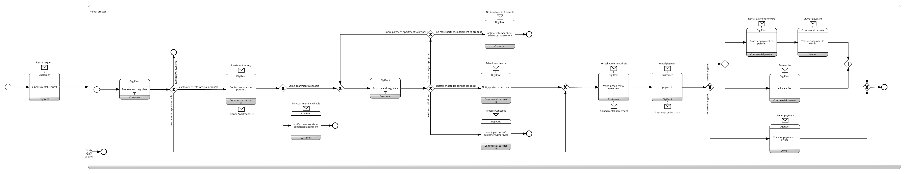
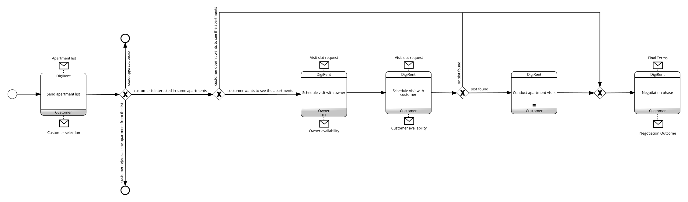

# My Project

## Members of the group:
* member A (Caterina, Gerini, 10810379) 
* member B (Christian, Prendin, 10827556)

## Choreographed process
This is the choreography diagram of our DigiRent apartment rental process. The participants are: Customer, DigiRent, Owner, and Commercial Partner. The process is initiated by the Customer, who submits a rental request to DigiRent. DigiRent first attempts to fulfill the request using its internal apartment database through a propose-and-negotiate phase, which covers apartment shortlisting, optional visit scheduling, and final negotiation. If the internal phase is unsuccessful, DigiRent contacts all available commercial partners in parallel to source additional apartments, iterating through each partner's listings until an agreement is reached or all options are exhausted. The entire process must conclude within 20 days from the initial request; otherwise it is considered terminated. Upon a successful outcome, the customer signs the rental agreement and proceeds with payment. If a commercial partner was involved, DigiRent allocates a percentage of the agency fee to that partner.

  

### Propose and Negotiate — sub-choreography detail

  

## Collaboration Diagram
The collaboration diagram models DigiRent as a white-box pool, showing its full internal orchestration. Customer, Owner, and Commercial Partner are modeled as black-box pools. All interactions between DigiRent and the other participants are made explicit through named message flows.

  

## Petri Net

place here the image of the PetriNet corresponding to the Baby360 executable model

## Third party services

List of the third party services that corresponds to the black boxes in the collaboration diagram

## Executable process

Place here an image of the BPMN diagram corresponding to the executable model of the DigiRent process

